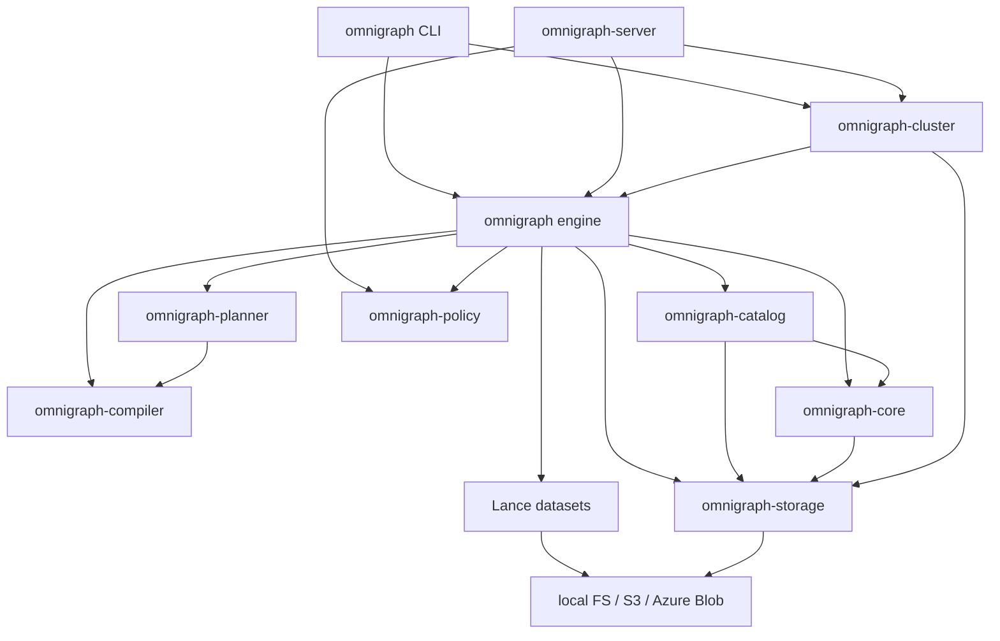

# Architecture

**Audience:** contributors and maintainers
**Authority:** current system boundaries and ownership; detailed protocols live
in the linked area guides

OmniGraph is a typed property-graph engine that coordinates many Lance
datasets. Lance supplies columnar storage, per-dataset versions, branches,
transactions, and indexes. OmniGraph adds one accepted graph schema, one
graph-wide visibility boundary, graph query and mutation semantics, policy,
cluster deployment state, and public CLI/HTTP surfaces.

## System shape

These are separate libraries and binaries, not one monolithic process. An
embedded caller may use the engine directly; the CLI may use an embedded store
or the HTTP API; the server hosts multiple graphs from one applied cluster
revision.

The CLI's [scope resolver](../../crates/omnigraph-cli/src/scope.rs) selects an
ordinary scope from supplied flags, operator configuration and an ambient profile
value. Its `resolve_scope_from_env` boundary captures `OMNIGRAPH_PROFILE`;
configuration loading, credential acquisition and server discovery remain with
their existing callers.

## Authority model

Three kinds of state must not be conflated:

1. **Accepted graph state.** Accepted SchemaIR owns rename-stable type,
   property, and table-incarnation identities. `__manifest` owns the graph
   branch heads, visible table versions, and graph lineage. One manifest
   publication makes a graph change visible.
2. **Lance physical state.** Each node and edge table is a Lance dataset with
   its own versions, branches, fragments, and indexes. Graph writes stage detached
   versions; a registered table's linear HEAD remains at its creation version.
3. **Derived runtime state.** Topology indexes, physical index coverage,
   caches, fragment layout, and serving projections may be rebuilt. They never
   become a second authority for graph contents.

Names and paths are diagnostic aliases. A supported rename preserves stable
identity and table history; drop/re-add creates a new lifetime even if the
alias is reused. See [invariants.md](invariants.md) and
[versioning.md](versioning.md).

## Layers and ownership

| Layer | Owns |
|---|---|
| `omnigraph-compiler` | `.pg` and `.gq` parsing, catalog, type checking, lint, migration planning, and typed IR lowering. It has no Lance dependency. |
| `omnigraph-planner` | Logical and physical plans, optimizer passes, cost estimates and explain documents; metadata enters through `PlanSource`, with no Lance dependency. |
| `omnigraph` (`omnigraph-engine`) | The public facade (`Omnigraph`, `Snapshot`), the graph coordinator, query and mutation execution, the table store, graph topology, validation, and recovery. |
| `omnigraph-catalog` | `__manifest` publication (multi-dataset publication), graph branch registrations and lineage, retention, and `commit_graph`. |
| `omnigraph-core` | `OmniError`, Lance dataset access and instrumentation, native Lance branch ref control (`branch_control`), and dataset addressing. |
| `omnigraph-storage` | Shared local/S3/Azure control-object access for cluster state, locks, immutable resources and legacy conversion evidence. |
| Lance | Dataset files, transactions, versions, native refs, secondary indexes, compaction, and version cleanup. |
| `omnigraph-policy` | Cedar compilation and the engine-facing action/scope/actor gate. |
| `omnigraph-cluster` | Desired configuration, deployment ledger, plan/apply, exact recovery, and immutable serving snapshots. |
| `omnigraph-api-types` | Additive HTTP wire DTOs shared by server and CLI. |
| `omnigraph-cli` | Operator commands, target resolution, output, embedded/remote dispatch, and local credential selection. Client setup captures operator configuration for ordinary graph commands, aliases and served cluster commands; scope, endpoint, credential matching and direct-write actor selection use those captured values. Query and alias presentation uses the same captured configuration. |
| `omnigraph-skill` | The `skills/omnigraph` agent skill, embedded byte for byte by its build script; the package root is `skills/`, so the skill tree stays its one copy. `omnigraph skill export` writes it. |
| `omnigraph-server` | HTTP authentication, read authorization, admission control, routing, OpenAPI, multi-graph serving and live deployment activation. |
| `omnigraph-azure-admission` | Azure deployment wrapper that admits one mutation-capable server process through the root-derived Blob lease. It is not a storage backend. |
| `omnigraph-gqt-core` | GQT format, ordinary session execution and expectation checks, shared by the GQT runner and benchmark harness. It has no build script or test-only engine dependency. |
| `omnigraph-reference-engine` | Engine v1, frozen (`publish = false`, hash-pinned by its `tests/frozen.rs`): the reference executor a GQT step's `--- expect same as v1` compares engine v2 against. Its input is the pinned `omnigraph_compiler::ir::untyped` read IR, produced by one-way erasure only at the test reference door. It depends only on `omnigraph-compiler`, `omnigraph-core`, `omnigraph-catalog` and third-party crates; `omnigraph-gqt` is the only crate that may depend on it (`forbidden_apis.rs` guards both), and no production door reaches it. |

The CLI's [invocation parser](../../crates/omnigraph-cli/src/invocation.rs) owns
command construction, explicit argument provenance and cross-level argument
validation. It reads no operator configuration or command inputs. The
[library](../../crates/omnigraph-cli/src/lib.rs) exposes the
[application entry point](../../crates/omnigraph-cli/src/app.rs), which owns
dispatch, invocation-scoped admission and outcome evidence, and completion
reporting. A completion carries the exit status of an already handled invocation;
an unrendered error remains a `Result` error. The
[binary](../../crates/omnigraph-cli/src/main.rs) owns runtime startup, diagnostic
hooks, process arguments and the final process exit status.

`commands/query` owns `query`, `mutate` and alias execution. Its
[pure preparation](../../crates/omnigraph-cli/src/commands/query/prepare.rs)
classifies captured source and argument combinations without I/O. It enforces
recognized statement restrictions while forwarding unrecognized source unchanged
to its execution owner, preserving syntax supported by a newer server.
[Read presentation](../../crates/omnigraph-cli/src/presentation.rs) captures the
effective format and table options once; rendering does not reload configuration.
The captured read format also selects structured execution-error output, while
mutation error formatting remains tied to explicit `--json`.

`commands/history` owns branch, commit, diff, change-feed and snapshot commands.
Its preparation types distinguish a requested page from automatic pagination and
preserve optional branch selection. Human and JSON renderers use fallible writers;
streams flush each page before requesting another. Baseline capture holds its
output-file lock through durable installation and resume-cursor delivery, including
the cursor flush. Dedicated commit publication and drop share the application's
write-outcome observation with their `mutate` statement forms.

`commands/transfer` owns `load`, `export` and Blob commands. Blob input capture
validates ranges and write preconditions before resolving a graph. Stdin comes
from a supplied reader; file and stdin payloads retain the existing byte bound.
Load retains its source path: `GraphClient` owns backend-specific input reads and managed limits,
including the embedded writable open before the source read. Transfer handlers
use supplied output writers; stream and receipt delivery failures return through
application completion with any write evidence retained. Blob output files keep
their existing deferred open and partial-transfer behavior.

`commands/schema` owns initialization, schema commands and lint. The handlers
preserve each command's source-read and target-resolution order, including cluster
ownership refusals before init/apply source reads and offline lint without target
resolution. They render through supplied writers. Schema apply keeps the existing
client's write evidence; initialization and system-column upgrade retain their
own execution paths and do not claim the data-write outcome envelope. The upgrade
adapter keeps its separate read-only check and execution modes.

`commands/maintenance` owns optimize, repair, cleanup, full-text index rebuilding
and storage upgrade arguments and dispatch. Supplied output writers keep delivery
failures in application completion. Cleanup retains preview and consent before
write admission; rebuild retains its actor and branch; repair delivers its report
before any refusal error. The storage-upgrade adapter retains its existing
conversion and recovery owner. These commands do not use the data-write outcome
envelope or replay an operation after delivery failure.

`commands/cluster` owns direct cluster arguments and dispatch; `cluster_remote`
owns served deployment submission and observation. `commands/control` owns applied
stored-query inspection, policy tooling and graph listing. Their reports use the
application's supplied writers. Served apply writes and flushes its original ID
before sending the POST. Direct apply's core identity callback cannot return an
error: the CLI captures any diagnostic delivery failure, lets that one core call
finish, then returns the failure with its original ID, root and retained lock.
Neither path replays work to recover output. Deployment and recovery authority
remain in the cluster crate.

CLI unit tests own invocation preparation and presentation; CLI process tests
own argument, environment, configuration, transport, output and exit behavior.
GQT owns query semantics across its execution adapters. Keep those boundaries
separate when extending the existing owners in [testing](testing.md#server-and-cli-ownership).

## Principal flows

- A read resolves one branch or snapshot and keeps that immutable view for the
  full query. The compiler produces typed IR; the executor combines Lance
  scans/search with the scoped in-memory topology index. See
  [execution.md](execution.md).
- A content write captures one accepted authority view, stages exact Lance
  transactions as unreachable detached table versions, and publishes every table
  pin, accepted schema and lineage change in one manifest CAS. See [writes.md](writes.md) and
  [recovery.md](recovery.md).
- A merge performs a graph-level three-way comparison, validates the selected
  result, stages its table effects, and uses the same publication boundary. A
  fast forward that only inserts nodes of types with no `@unique`, `@range`,
  `@check` or enum property skips the validation. See [merge.md](merge.md).
- Blob cells use an engine-owned, snapshot-bound facade; callers never receive
  a raw Lance `BlobFile` or physical placement. See [blob.md](blob.md).
- Cluster apply converges definitions and graph topology into a CAS-protected
  ledger. Servers boot from an applied serving snapshot and execute live
  deployments under their existing exclusive cluster admission. See [control-plane.md](control-plane.md).

## Trust and policy boundaries

HTTP authentication resolves a bearer token to an actor; the client cannot set
that actor identity. Server handlers enforce read and transport-specific
policy. Mutating engine entry points enforce Cedar again through their `_as`
surface, so embedded and CLI-direct writers cannot bypass the graph write gate.
No-policy embedded development remains an explicit engine configuration.

Admission and authorization are different controls. `WorkloadController`
bounds served work, and the write queue orders in-process effects; neither is a
durable cross-process lock. Azure has the additional deployment admission
wrapper because mutation-capable Azure replicas must not rely on process-local
gates for single-writer ownership.

## Concurrency and support boundary

- Reads are snapshot-isolated. A read-view capture takes a shared schema
  permit (so it cannot observe a contract mid-swap) and no branch or table
  gate, so it does not wait for writers on other handles. It does wait for
  an exclusive pass on any handle of the process (schema apply, the
  system-column upgrade, open, refresh, settle, reload, `sync_branch`,
  branch create), and, because the gate is write-preferring, from the
  moment one is queued. It also takes its
  handle's coordinator lock, which a publish on that handle's bound branch
  holds for the manifest compare-and-swap: a read and a write sharing one
  handle and branch (for example, the server's requests on `main`) still
  wait for each other there.
- Write preparation may overlap. Durable effects are ordered by the shared
  schema, branch, and sorted-table gates, then fenced again by persisted
  authority and Lance transaction identity.
- The gates prevent same-process races and deadlocks; manifest preconditions,
  Lance transactions, and accepted manifest identities provide durable correctness.
- Some maintenance and destructive-recovery classifiers intentionally retain
  a one-mutation-process support boundary. Do not infer distributed writer
  safety from an in-process mutex. [recovery.md](recovery.md) names the modes.
- Missing physical indexes or stale cache entries may change cost, never query
  meaning. Explicit reconciliation restores physical coverage.

## Storage failure boundary

`omnigraph-storage` classifies substrate evidence as `Transient`,
`Configuration`, `NotFound`, `Precondition`, `Permanent`, or `Unknown`.
The engine preserves that evidence in `OmniError::Storage(StorageFailure)`
instead of flattening Lance, `object_store`, or filesystem failures into
strings. `StorageFailure::is_transient()` is true only for positive transient
evidence; it is not permission to replay an operation. The operation that owns
the effect boundary still decides whether a retry is safe, and unknown evidence
stays unknown. [RFC 0038](../rfcs/0038-typed-storage-failures.md) records the
rationale and compatibility change.

## Storage backends

Graph datasets and cluster control objects support local paths, S3-compatible
URIs, and native Azure Blob `az://` roots. Azure remains a qualification
preview while the adversarial live-Azure matrix is pending; the narrower
managed-identity smoke proof is complete. Any mutation-capable
Azure server must run through `omnigraph-azure-admission`; direct server boot is
for read-only qualification and tests, not writer ownership.

Upstream behavior must be checked against the full matching Lance pages in
[lance.md](lance.md) before changing a substrate-facing contract.

## Index facts in read planning

The engine gathers effective index metadata from each query table at its pinned
version, including correlated inner reads. `PlanSource` exposes one fact per
index name and keyed column. Coverage unions same-name segments and intersects
current fragments; missing bitmaps remain unknown. The planner prices Expand
as fully indexed only when every required endpoint has complete usable BTREE
coverage across its candidates. See the [index-facts decision](../rfcs/2026-10-08-index-facts-as-planner-input.md).

Saved Expand inputs carry coverage provenance. Fresh plans use pinned facts;
accepted older plans with no provenance default to the legacy runtime probe.
Execution still adjusts for frontier size and warm CSR state. Explain statistics
are diagnostics and do not select the replay path. Root scans finalize their access through the same Lance read builder used by
execution. Static scans record a Boolean index query and residual or disable
indexing. A filtered scan whose table has no fact that could narrow it (no
index, or only indexes covering no current fragment, such as an untrained
full-text segment) records sequential access without building that read. Dynamic and dependent reads keep their explicit runtime paths.
Single String key equality can gain a canonical identity predicate before
finalization; historical IDs prevent broader key narrowing.
